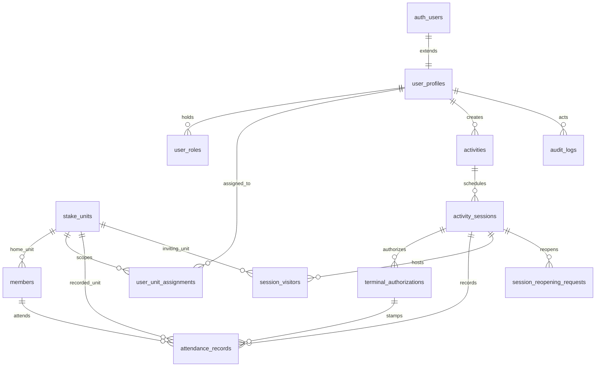

# YSA AMS — Database Architecture Specification
**Abeokuta Nigeria Obantoko Stake | The Church of Jesus Christ of Latter-day Saints**
**Document Version:** 1.0.0 (Phase 2A Baseline Design)  
**Database Engine:** PostgreSQL 15+ (Supabase)  
**Timezone Standard:** `Africa/Lagos` (UTC+1)

---

## 1. Architectural Principles

1. **Normalized Relational Design:** Clear separation of concerns between units, identity, activity planning, live attendance instances, terminal credentials, and immutable audit logs.
2. **Server-Enforced Authorization:** Every table enforces PostgreSQL Row-Level Security (RLS). Privileged actions operate through hardened `SECURITY DEFINER` functions with fixed `search_path = public, extensions, pg_temp`.
3. **Zero Self-Registration:** Leadership accounts cannot be self-registered via public Auth. Users and roles are provisioned exclusively through authorized administrative workflows.
4. **Historical Attribution Integrity:** When members transfer wards or branches, their historical attendance records retain the `recorded_unit_id` captured at check-in time.
5. **Atomic Concurrency Protection:** Terminal redemption and slot quota checks serialize concurrent requests using row-level locking (`FOR UPDATE`) to prevent race conditions.
6. **No Invented Seed Data:** Units, leaders, and members are not seeded with placeholder data. Real unit lists await official confirmation.

---

## 2. Entity-Relationship Overview



---

## 3. Normalized Table Schema Definitions

### 3.1 `public.stake_units`
Represents wards and branches across Abeokuta Nigeria Obantoko Stake.
```sql
CREATE TABLE public.stake_units (
    id UUID PRIMARY KEY DEFAULT gen_random_uuid(),
    unit_name TEXT NOT NULL UNIQUE,
    unit_type TEXT NOT NULL CHECK (unit_type IN ('ward', 'branch')),
    is_active BOOLEAN NOT NULL DEFAULT TRUE,
    created_at TIMESTAMPTZ NOT NULL DEFAULT timezone('utc'::text, now()),
    updated_at TIMESTAMPTZ NOT NULL DEFAULT timezone('utc'::text, now())
);
```

### 3.2 `public.user_profiles`
Application profile linked 1-to-1 with Supabase Auth (`auth.users`).
```sql
CREATE TABLE public.user_profiles (
    id UUID PRIMARY KEY REFERENCES auth.users(id) ON DELETE CASCADE,
    full_name TEXT NOT NULL,
    email TEXT,
    account_status TEXT NOT NULL DEFAULT 'active' CHECK (account_status IN ('active', 'deactivated', 'pending')),
    created_at TIMESTAMPTZ NOT NULL DEFAULT timezone('utc'::text, now()),
    updated_at TIMESTAMPTZ NOT NULL DEFAULT timezone('utc'::text, now())
);
```

### 3.3 `public.user_roles`
Explicit role assignments with protection against removing the final administrator.
```sql
CREATE TABLE public.user_roles (
    id UUID PRIMARY KEY DEFAULT gen_random_uuid(),
    user_id UUID NOT NULL REFERENCES public.user_profiles(id) ON DELETE CASCADE,
    role_name TEXT NOT NULL CHECK (
        role_name IN ('system_admin', 'ysa_leader', 'stake_presidency', 'bishop', 'branch_president')
    ),
    assigned_by UUID REFERENCES public.user_profiles(id) ON DELETE SET NULL,
    created_at TIMESTAMPTZ NOT NULL DEFAULT timezone('utc'::text, now()),
    CONSTRAINT uq_user_role UNIQUE (user_id, role_name)
);
```

### 3.4 `public.user_unit_assignments`
Scopes unit leaders (Bishop to Ward, Branch President to Branch, Unit YSA Leader to Ward/Branch).
```sql
CREATE TABLE public.user_unit_assignments (
    id UUID PRIMARY KEY DEFAULT gen_random_uuid(),
    user_id UUID NOT NULL REFERENCES public.user_profiles(id) ON DELETE CASCADE,
    unit_id UUID NOT NULL REFERENCES public.stake_units(id) ON DELETE CASCADE,
    assigned_role TEXT NOT NULL CHECK (
        assigned_role IN ('bishop', 'branch_president', 'ysa_leader')
    ),
    assigned_by UUID REFERENCES public.user_profiles(id) ON DELETE SET NULL,
    created_at TIMESTAMPTZ NOT NULL DEFAULT timezone('utc'::text, now()),
    CONSTRAINT uq_user_unit_role UNIQUE (user_id, unit_id, assigned_role)
);
```

### 3.5 `public.members`
YSA member registry. Minimal personal data collection with stable unit attribution.
```sql
CREATE TABLE public.members (
    id UUID PRIMARY KEY DEFAULT gen_random_uuid(),
    member_number TEXT UNIQUE, -- Optional stable church/stake identifier
    full_name TEXT NOT NULL,
    preferred_name TEXT,
    gender TEXT CHECK (gender IN ('male', 'female')),
    phone_number TEXT,
    email TEXT,
    home_unit_id UUID NOT NULL REFERENCES public.stake_units(id) ON DELETE RESTRICT,
    is_active BOOLEAN NOT NULL DEFAULT TRUE,
    created_at TIMESTAMPTZ NOT NULL DEFAULT timezone('utc'::text, now()),
    updated_at TIMESTAMPTZ NOT NULL DEFAULT timezone('utc'::text, now())
);
```

### 3.6 `public.activities`
Reusable activity definitions and planning templates.
```sql
CREATE TABLE public.activities (
    id UUID PRIMARY KEY DEFAULT gen_random_uuid(),
    title TEXT NOT NULL,
    description TEXT,
    category TEXT NOT NULL CHECK (
        category IN ('spiritual', 'social', 'service', 'sports', 'temple', 'educational', 'other')
    ),
    default_participating_units UUID[] DEFAULT NULL, -- NULL indicates stake-wide
    created_by UUID NOT NULL REFERENCES public.user_profiles(id) ON DELETE RESTRICT,
    created_at TIMESTAMPTZ NOT NULL DEFAULT timezone('utc'::text, now()),
    updated_at TIMESTAMPTZ NOT NULL DEFAULT timezone('utc'::text, now())
);
```

### 3.7 `public.activity_sessions`
Live activity instances for attendance taking.
```sql
CREATE TABLE public.activity_sessions (
    id UUID PRIMARY KEY DEFAULT gen_random_uuid(),
    activity_id UUID NOT NULL REFERENCES public.activities(id) ON DELETE RESTRICT,
    session_title TEXT NOT NULL,
    session_date DATE NOT NULL,
    start_time TIME NOT NULL,
    scheduled_end_time TIME,
    timezone TEXT NOT NULL DEFAULT 'Africa/Lagos',
    status TEXT NOT NULL DEFAULT 'draft' CHECK (status IN ('draft', 'active', 'closed')),
    participating_units UUID[] DEFAULT NULL,
    visitor_registration_enabled BOOLEAN NOT NULL DEFAULT TRUE,
    max_terminals INT NOT NULL DEFAULT 1 CHECK (max_terminals >= 1 AND max_terminals <= 10),
    code_hash TEXT, -- SHA-256 hash of uppercase 6-char code
    code_expires_at TIMESTAMPTZ,
    initiated_by UUID REFERENCES public.user_profiles(id) ON DELETE SET NULL,
    initiated_at TIMESTAMPTZ,
    closed_by UUID REFERENCES public.user_profiles(id) ON DELETE SET NULL,
    closed_at TIMESTAMPTZ,
    created_at TIMESTAMPTZ NOT NULL DEFAULT timezone('utc'::text, now()),
    updated_at TIMESTAMPTZ NOT NULL DEFAULT timezone('utc'::text, now())
);
```

### 3.8 `public.terminal_authorizations`
Cryptographically authorized kiosk devices with 10-minute heartbeat leases.
```sql
CREATE TABLE public.terminal_authorizations (
    id UUID PRIMARY KEY DEFAULT gen_random_uuid(),
    session_id UUID NOT NULL REFERENCES public.activity_sessions(id) ON DELETE CASCADE,
    terminal_token_hash TEXT NOT NULL UNIQUE, -- SHA-256 hash of 32-byte bearer token
    terminal_label TEXT NOT NULL,
    lease_expires_at TIMESTAMPTZ NOT NULL DEFAULT (timezone('utc'::text, now()) + interval '10 minutes'),
    is_revoked BOOLEAN NOT NULL DEFAULT FALSE,
    revoked_at TIMESTAMPTZ,
    last_seen_at TIMESTAMPTZ NOT NULL DEFAULT timezone('utc'::text, now()),
    created_at TIMESTAMPTZ NOT NULL DEFAULT timezone('utc'::text, now())
);
```

### 3.9 `public.attendance_records`
Official check-ins for Church members with historical unit preservation.
```sql
CREATE TABLE public.attendance_records (
    id UUID PRIMARY KEY DEFAULT gen_random_uuid(),
    session_id UUID NOT NULL REFERENCES public.activity_sessions(id) ON DELETE RESTRICT,
    member_id UUID NOT NULL REFERENCES public.members(id) ON DELETE RESTRICT,
    recorded_unit_id UUID NOT NULL REFERENCES public.stake_units(id) ON DELETE RESTRICT,
    recorded_by_terminal_id UUID REFERENCES public.terminal_authorizations(id) ON DELETE SET NULL,
    check_in_time TIMESTAMPTZ NOT NULL DEFAULT timezone('utc'::text, now()),
    created_at TIMESTAMPTZ NOT NULL DEFAULT timezone('utc'::text, now()),
    CONSTRAINT uq_session_member_attendance UNIQUE (session_id, member_id)
);
```

### 3.10 `public.session_visitors`
Non-member visitor attendance with optional inviting ward/branch attribution.
```sql
CREATE TABLE public.session_visitors (
    id UUID PRIMARY KEY DEFAULT gen_random_uuid(),
    session_id UUID NOT NULL REFERENCES public.activity_sessions(id) ON DELETE RESTRICT,
    full_name TEXT NOT NULL,
    contact_phone TEXT,
    is_church_member BOOLEAN NOT NULL DEFAULT FALSE,
    inviting_unit_id UUID REFERENCES public.stake_units(id) ON DELETE SET NULL,
    recorded_by_terminal_id UUID REFERENCES public.terminal_authorizations(id) ON DELETE SET NULL,
    created_at TIMESTAMPTZ NOT NULL DEFAULT timezone('utc'::text, now())
);
```

### 3.11 `public.session_reopening_requests`
Audited requests to reopen closed sessions.
```sql
CREATE TABLE public.session_reopening_requests (
    id UUID PRIMARY KEY DEFAULT gen_random_uuid(),
    session_id UUID NOT NULL REFERENCES public.activity_sessions(id) ON DELETE CASCADE,
    requested_by UUID NOT NULL REFERENCES public.user_profiles(id) ON DELETE RESTRICT,
    reason TEXT NOT NULL,
    authorized_by UUID REFERENCES public.user_profiles(id) ON DELETE SET NULL,
    authorized_at TIMESTAMPTZ,
    reopen_until TIMESTAMPTZ,
    created_at TIMESTAMPTZ NOT NULL DEFAULT timezone('utc'::text, now())
);
```

### 3.12 `public.audit_logs`
Append-only immutable audit trail.
```sql
CREATE TABLE public.audit_logs (
    id UUID PRIMARY KEY DEFAULT gen_random_uuid(),
    actor_id UUID REFERENCES public.user_profiles(id) ON DELETE SET NULL,
    action TEXT NOT NULL,
    target_record_id TEXT,
    target_table TEXT,
    outcome TEXT NOT NULL DEFAULT 'success' CHECK (outcome IN ('success', 'failure')),
    metadata JSONB DEFAULT '{}'::jsonb,
    created_at TIMESTAMPTZ NOT NULL DEFAULT timezone('utc'::text, now())
);
```

---

## 4. Key Stored Procedures & Business Logic RPCs

1. `authorize_terminal(p_session_code, p_terminal_label, p_existing_token)`:
   - Locks `activity_sessions` row (`FOR UPDATE`).
   - Checks session status (`active`) and code expiry.
   - Cleans up expired leases (`lease_expires_at < now()`).
   - Reconnects existing active token if valid.
   - Enforces `active_terminals < max_terminals`.
   - Issues 32-byte bearer token and 10-minute lease.
2. `heartbeat_terminal_lease(p_terminal_token)`:
   - Verifies active terminal and active session.
   - Extends `lease_expires_at` by 10 minutes.
3. `release_terminal(p_terminal_token)`:
   - Explicitly revokes lease, immediately freeing quota.
4. `record_attendance(p_session_id, p_member_id, p_terminal_token)`:
   - Verifies terminal token lease and session status.
   - Rejects if session is closed.
   - Verifies unit eligibility.
   - Enforces unique check-in (`uq_session_member_attendance`).
5. `close_attendance_session(p_session_id)`:
   - Closes session, invalidates subsequent writes, and logs audit event.
6. `reopen_attendance_session(p_session_id, p_reason, p_duration_minutes)`:
   - Verifies caller has `system_admin` or `stake_presidency` role.
   - Records request reason and logs audit event.
